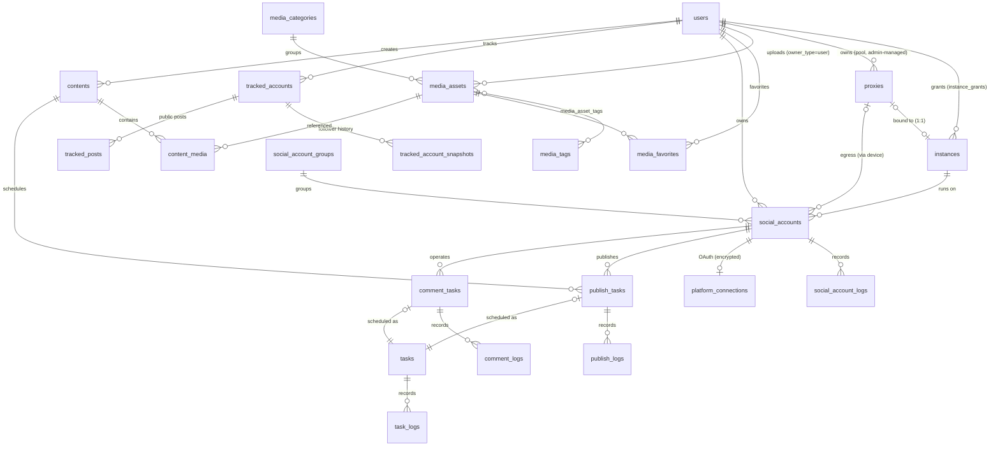

# 社交媒体运营平台：架构分析、数据关系与实施计划

日期：2026-11-14　依据：现有代码（commit 0ff1d20）+ 需求文档「扩展社交媒体运营管理平台」「素材管理系统」

## 1. 现有架构（可复用部分）

| 能力 | 现有实现 | 社媒模块如何复用 |
|---|---|---|
| 认证 / RBAC | JWT；admin / user；`instance_grants`；内置管理员 | 所有新业务表带 `user_id`，后端统一用 `isAdmin` + 所有权检查 |
| 云手机设备 | `instances`（UI 称"设备"），生命周期 BullMQ，监控，远程控制（含受保护画面），文件推送 | 社交账号关联设备；人工执行任务时在该设备上远程操作 |
| 代理 | 每设备 sing-box 边车 + nftables 断线阻断；代理目前存于 `instances.proxy` | 改为**代理池**（wave 1），账号/设备引用代理池 |
| 素材 | `assets` + 存储适配器（本地 / S3），推送走 adb（不经住宅代理） | 升级为 **media_assets**（wave 1），内容引用素材 |
| 任务 | BullMQ 队列 `instance-ops` + `tasks` 表（设备操作），实时事件推送 | 扩展为**统一任务中心**（wave 2）：所有业务任务同一套调度 |
| 敏感信息 | `secret-box`（AES-256-GCM），写入后不回显 | OAuth token、平台凭证加密保存 |
| 审计 | `audit_logs`（所有修改请求，脱敏） | 新模块自动纳入 |
| 国际化 / 主题 | vue-i18n（zh-CN/en）、亮暗模式 | 新页面沿用 |

## 2. 数据关系

要点：
- **账号与设备分离**：`social_accounts.instance_id` 外键；同平台每设备账号数上限可配置（默认 1）。
- **统一任务**：业务表（publish_tasks、comment_tasks…）存业务数据，`tasks` 存调度状态（pending / scheduled / running / success / failed / cancelled）、尝试次数、幂等键、超时；`task_logs` 存执行日志。设备操作沿用同一张表。
- **所有私有数据带 `user_id`**；admin 可管理全部。

## 3. 平台集成方式（合规边界）

| 平台 | 发布 | 评论 | 追踪公开数据 | 需要用户提供 |
|---|---|---|---|---|
| YouTube | Data API v3 `videos.insert`（OAuth） | `commentThreads` 读取 / 回复 | `channels.list`（API Key，公开统计） | Google Cloud 项目、OAuth Client、API Key |
| Instagram | Graph API（仅商业 / 创作者账号）：媒体容器 → 发布 | Graph API 评论读取 / 回复 | Business Discovery（需自己的商业账号 token） | Meta 开发者应用 + 权限审核 |
| TikTok | Content Posting API（直发需审核；否则上传到草稿箱） | 官方 API 能力有限，默认人工 | 官方 API 受限 → 人工录入快照 | TikTok 开发者应用 + 审核 |

- 每个平台通过 `PlatformAdapter` 接口声明能力（`capabilities`），调度器只调用平台支持的方式。
- **人工模式**（所有平台可用）：任务分派给操作员，在绑定的云手机上通过远程控制完成，并回填结果。这是不具备 API 授权时的合规执行方式。
- **不实现**：云手机 UI 自动化代发 / 代评论（各平台条款禁止）、绕过限制的抓取、批量垃圾评论、虚假互动、规避反滥用机制。
- 平台账号密码**默认不存储**；如需保存，仅加密且写入后不回显。

## 4. 实施计划（多个子任务并行，按波次合并）

并行规则：每个子任务使用独立 git worktree、独立数据库 / Redis DB / API 端口 / 网页端口 / 设备端口段，互不干扰；合并时统一重新生成数据库迁移，并在主环境复测后提交。

| 波次 | 并行子任务 | 内容 |
|---|---|---|
| **W1** | A 素材系统 | media_assets / 分类 / 标签 / 收藏，公共 / 私有 / 收藏三标签页，缩略图与视频元数据，替换 `assets` |
| | B 代理池 | 静态住宅代理池（加密密码、批量导入、检测、独占绑定），创建设备时自动分配 |
| **W2** | C 社交账号（P1） | 账号、分组、标签、状态、日志，关联设备与代理，平台数量限制 |
| | D 追踪账号（P2） | 外部账号、快照历史、公开内容、收藏 |
| | E 统一任务核心（P6 核心） | `tasks` 泛化（状态 / 幂等 / 超时 / 重试 / 日志），任务中心页面 |
| **W3** | F 内容 + 定时发布（P3+P4） | 内容、素材关联、多账号分发与独立文案、发布日历、待发布队列、重试 |
| | G 平台适配器 | PlatformAdapter：YouTube / Instagram / TikTok OAuth 与官方 API 客户端、人工模式 |
| **W4** | H 评论与互动（P5） | 评论列表、回复任务、人工撰写、审核、防重复 / 限频 |
| | I Dashboard + Settings | 概览统计、平台凭证 / 限制 / 存储等设置集中页 |

每个波次结束：类型检查、各模块真实 API 测试、浏览器检查，然后提交。官方 API 的端到端测试需要你提供各平台开发者凭证；未提供前，以人工模式 + 调度器测试为准，并在报告中注明。
